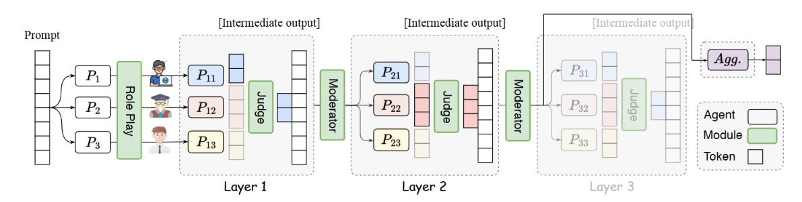

# Reference-led LLM schematics

Use when a user supplies a figure to emulate, rejects an existing style, or asks
for more visual objects in an LLM method figure. This is a conditional style
profile, not a new universal palette.

## Bundled visual reference

The original 1191 x 302 PNG above was supplied by the user on 2026-10-13.
Inspect the image itself before reference-led styling; prose descriptions alone
previously produced diagrams the user rejected. Source publication and reuse
license are unspecified: keep it as a private style reference, not an image to
insert into unrelated papers.

For this reference, transfer its light blue/pink/cream content, pale green
operators, lavender artifacts, dashed light-gray stage groups, serif regular
type, fine outlines and semantic token strips. Avoid replacing that grammar
with bold sans-serif headings, dark blue bars, open bracket grids or gray
dashboard cards and then calling it a match. Portraits and agent layers belong
only to methods that actually contain them.

For confidence-based token selection, numbers inside the cells often explain
Low/High better than empty masks. Keep the same probability row and positions
across selectors, tint retained cells, and leave omitted cells unfilled with
readable values. Make Low retain the smallest values and High the largest;
match the actual retention rule. State illustrative values and rounding in the
caption. This is a technique for numerical selection mechanisms, not a rule
to put numbers into every method figure.

## Extract the reference before choosing defaults

Record a compact mapping of reference feature → function in the new figure:
palette by role, grouping, type, outlines, geometry, object vocabulary, reading
path, and density. Inspect the actual reference; “pastel” alone is not a spec.

In the user-supplied role-play / judge / moderator reference, the recognizable
grammar is light blue/pink/cream content, pale green computations, lavender
output, pale gray dashed groups, thin near-black connectors, regular-weight
academic type, and actual token strips alongside small role illustrations.
Its softness comes from substantial pastel fills and light backgrounds, not
from washing out dark navy, teal or brick-red ink into nearly gray boxes.

For this profile, use explicit pastel fill colors at full opacity rather than
`darkBrandColor!5`. A starting role palette is:

| Role | Fill | Outline/text |
| --- | --- | --- |
| Primary content / first compared view | `#D8E5FA` | near-black |
| Contrasted content / second view | `#F4D9D6` | near-black |
| Rubric/context/shared content | `#FFF3CE` | near-black |
| Computation or editing module | `#DEECD7` | `#86AC70` outline, near-black text |
| Output artifact or policy | `#E5DCEA` | near-black |
| Stage group | `#F8F8F8` | thin dashed `#959595` |

Roles may be adapted to the method, but the two figures must share the mapping.
Do not silently redefine a color already used for a different quantitative
meaning elsewhere in the paper: add shared schematic-role palette tokens.
Keep foreground text dark. Reserve strong strokes or local highlights for the
novel operation. No gradients, shadows or dark title bands are needed here.
Use the reference's serif/regular typography when it fits the manuscript;
heavy bold sans-serif labels on every object are a different visual language.

## Map terms before shortening them

Extract the exact names from the method section, algorithm, stage table and
caption into a small source-term → figure-label mapping. Preserve named methods
and stages, decision literals, and their numbering where numbering is shown.
Wrap a long stage name over two lines instead of substituting a generic verb.
Plain-language guidance is for reducing notation, not renaming the method.

Check semantic authority as well as words: an advisory audit and a deterministic
acceptance gate are different operations. An attribution decision and a wording
edit are different operations. Do not collapse them into a single authoritative
“Audit” box merely to make the pipeline shorter. If the manuscript distinguishes
five prompt stages and a separate gate, the figure must preserve that distinction.

## Increase graphic content by replacing text

Use small, labeled vector objects that show what the method consumes, changes
or produces. Good choices for LLM papers include:

| Actual method object | Useful visual representation |
| --- | --- |
| Prompt, context, response | Labeled tiled token strip |
| Chosen/rejected pair | Two aligned strips, separate ports into the loss module |
| Model/policy | Small network or model glyph, with a plain-language label |
| Rubric / clause bank | Document with aligned Prefer/Avoid rows |
| Evidence from multiple tasks | Report sheets whose repeated marks converge |
| Factor attribution | Shared factor strip with one outlined cell |
| Local edit | Aligned before/after text; only changed words highlighted |
| Audit | Checklist/report object |
| Gate | Bounded computation with explicit accept/revert branches |

Choose objects that clarify this method; do not meet a quota of icons. A role
portrait is useful for genuinely different agent roles, but is inappropriate for
a pipeline that has no such agents. A network glyph should denote the policy as
one object, not suggest undocumented architectural changes. Decorative mascots,
emoji-per-panel and unrelated robot icons do not increase scientific content.

Name an enclosing TikZ node for every composite glyph or repeated strip so QA
sees its bounds. Derive its local strokes from the parent; do not let the icon
float outside the named extent. Schematic cells and checklists are not measured
results; explain their status in the caption. Checks must not imply that every
benchmark passed unless that is actually supported.

If the same figure contains both factor vectors and language-token sequences,
give them different local geometry: for example, a contiguous fixed-cell factor
axis versus spaced, variable-width text-marked tokens. Reusing identical blank
strips for both makes a response look like another factor vector even when its
color and label differ. Paired responses should retain matching geometry.

## Review the style and the mechanism separately

After mechanical QA, compare the render with the reference on: hue/lightness,
grouping, object vocabulary, type weight, line weight and density. A clean render
can still fail all six stylistic comparisons. Ask the independent reviewer to
review visual correspondence as well as trace every branch.

Blur or temporarily ignore text: prompt/response strips, rubric, operations and
output should remain distinguishable. Then read the text: exact manuscript
terms and advisory/decisive roles should still be recoverable. Finally inspect
at manuscript width. Add breathing room or shorten supporting prose before
shrinking canonical names.
